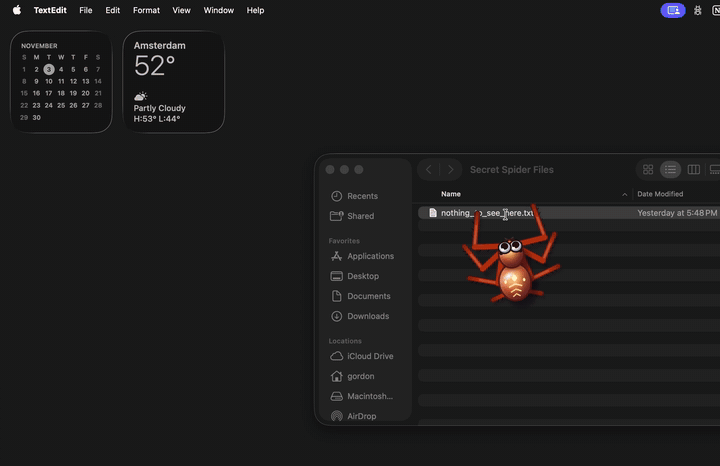
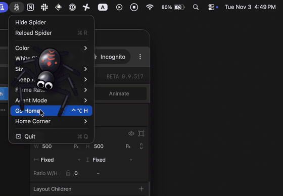

# Spider cursor

A cartoon spider, Silk, that crawls after your pointer. It walks on eight IK legs, presses with a front leg when you click (left click, left leg; right click, right leg), drags its feet along when you scroll, and finds something to do when you keep still: grooming, wandering, spinning a little web, dozing. Send it home and it spins a web in the corner, drops on a thread and swings. Drag a window it is near and it holds on.

| Holding on to a dragged window | Home in its corner web, changing colour |
|---|---|
|  |  |

It runs in three places:

- **Silkworks**, a full-page web app Silk lives in, with buttons, a scrolling list and a sticky note to drag about. This is what `rive .` opens.
- **Desktop**, a smaller test rig with a draggable window: `rive . --artboard=Desktop`.
- **A macOS app** that puts Silk on your real desktop, following the system pointer. See [mac](#macos-app).

## Run it

```sh
rive .
```

Opens the live player, rebuilding as you edit. Keys in the Desktop rig: `h` sends Silk home, `f` brings it back, `0` to `5` switch its mood.

## How it's made

The motion is code and the look is animation:

| File | What it does |
|---|---|
| `gait.luau` | Walking: when each leg steps, where it lands, presses and scrolls |
| `body.luau` | Weight: the abdomen's sway, leaning into a sprint, the landing dip |
| `life.luau` | Idle life: blinks, breathing, glances, foot taps, when to fall asleep |
| `will.luau` | What Silk wants beyond following: play, going home, holding on to windows |
| `silk.luau` | Webs, as geometry |
| `spider.luau` | Feeds all of the above from the view model and writes the pose back |
| `page.luau`, `stage.luau` | The Silkworks page's host: pointer, home corner, the sticky note |
| `scene.rml` | Artboards, the state machines and timelines, view models |

The scripts decide *when* (a blink, falling asleep, a mood) and the state machine's timelines decide *how it looks*, so the animation can be reworked in the Rive editor without touching code. Nodes named `(code)` are moved by scripts every frame; nodes named `(animate)` are there for animators. The `Read Me` artboard has notes for animators.

`tools/silkworks.py` generated the Silkworks page. Running it again replaces the page, so edit the page in the editor or in `scene.rml` once you change it by hand.

## Tests

```sh
rive . --test           # the Luau tests (*_test.luau)
python3 scene_test.py   # the scene's structure and wiring
python3 page_test.py    # plays the Silkworks page headless and checks scrolling
```

## macOS app

`mac/` is a menu-bar app that shows Silk in a transparent, click-through window over everything, fed by the system pointer.

```sh
rive login                # once: the app needs signed scripts, see below
mac/build.sh
open mac/build/SpiderCursor.app
```

`build.sh` downloads the public RiveRuntime, runs the Swift tests, and builds the app with a `.riv` from `rive . --publish`. Released Rive runtimes only run signed scripts, and `--publish` signs them; a `.riv` from `rive . --once` loads but the spider stands still.

The menu bar icon has moods, colours, the home corner and Reload Spider. Shortcuts: ctrl+option 0 to 5 for moods, ctrl+option H for home.

Limits: primary display only, and the real arrow stays visible.

## Notes

- A `--publish` of a project that is not linked to a Rive editor file is watermarked. Link it with `rive push` to remove the watermark.
- In the CLI's player (1.8.0) a right click presses the left leg, until a CLI fix ships. The macOS app tells the two apart.
- [Inter](https://github.com/rsms/inter) is included under the SIL Open Font License, see `Inter-LICENSE.txt`.
